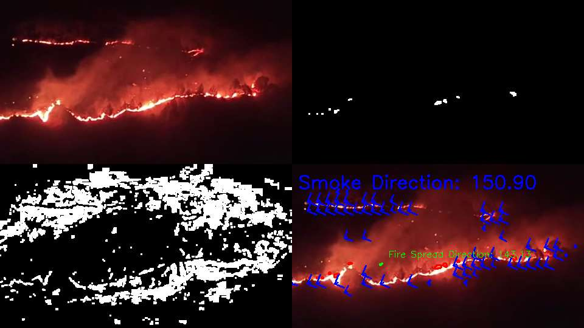
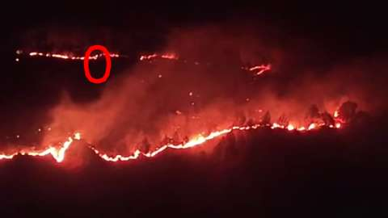
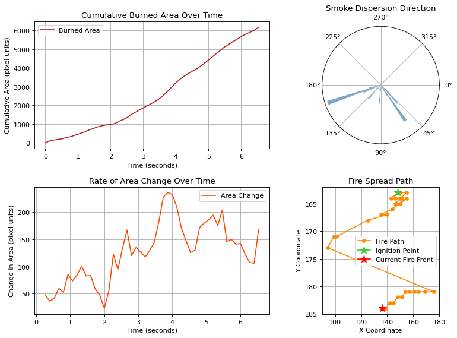
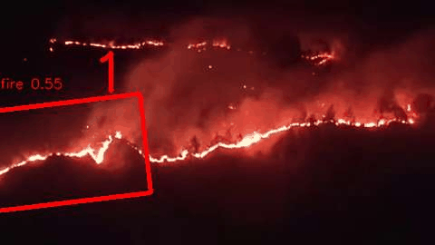
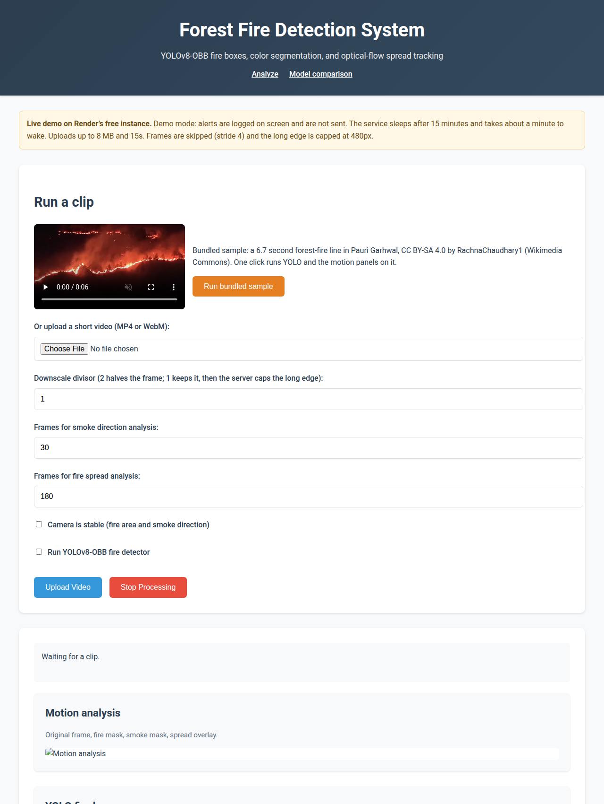
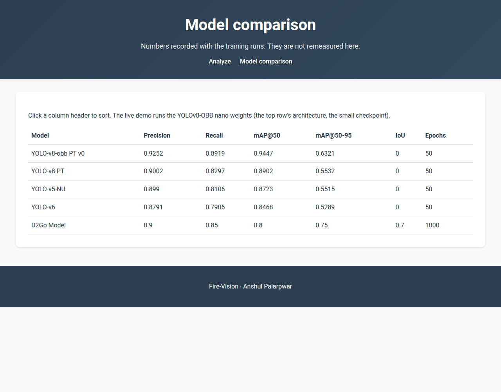
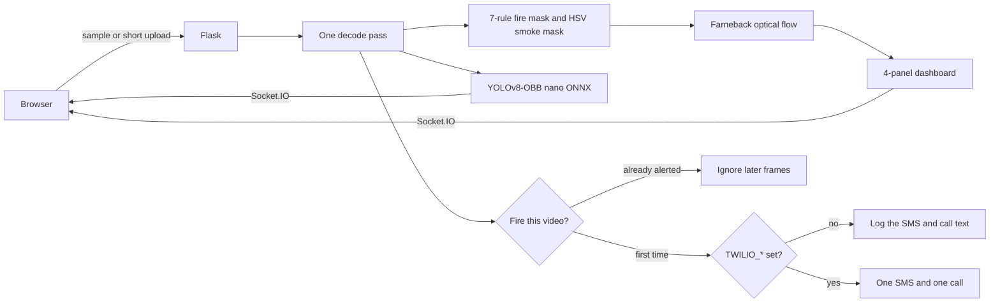

# Fire-Vision

Real-time fire and smoke perception for a fixed camera: a one-class YOLOv8-OBB detector, classical fire-color rules, and Farneback optical flow for spread and smoke direction. Built by **Anshul Palarpwar** as a new-grad computer-vision project, and packaged so a recruiter can run it on [Render’s free plan](https://render.com/docs/free).

**Live demo:** [https://fire-vision.onrender.com](https://fire-vision.onrender.com)

That hostname is the intended free-service URL. A free Render service sleeps after 15 minutes without a request and takes **about a minute** to wake; Render shows its own loading page during that cold start. The first processed frames show up after that, not at 30 fps. See [What the free CPU actually does](#what-the-free-cpu-actually-does).













## What it does



- **Fire boxes.** YOLOv8-OBB nano, one class (`fire`), exported to ONNX at 320 px and run with ONNX Runtime. The `.pt` checkpoint is still in the repo.
- **Fire area.** The same seven YCbCr / RGB rules as the original pipeline, then contours and a rolling centroid.
- **Smoke direction.** Low-saturation mask plus Farneback flow. The mask is broad; the direction is only meaningful on a stable camera. See limitations.
- **Spread arrow and dashboard.** Cumulative burned area, frame-to-frame area change, a polar smoke histogram, and the centroid path with ignition and current-front markers.
- **One alert per fire.** The first fire detection in a video sends one SMS and one call. Later frames do not. With Twilio unset, that text is logged and shown in the page. Nothing is sent.
- **One-click sample.** A 6.7 second CC BY-SA clip is bundled. Uploads are limited to 8 MB and 15 seconds.

## Stack

| Piece | Choice |
| --- | --- |
| Web | Flask, Flask-SocketIO, threading mode, one port |
| Vision | OpenCV, NumPy, the author’s YOLOv8-OBB weights |
| Runtime inference | ONNX Runtime CPU, 1 thread. PyTorch is not in the image |
| Plots | Matplotlib (Agg), 80 dpi |
| Alerts | Twilio, off unless all four env vars are set |
| Host | Render free Docker web service, Singapore, 0.1 CPU / 512 MB |

## Run it locally

```bash
python -m venv .venv
source .venv/bin/activate
pip install -r requirements.txt
python code_web/app.py
```

Open http://localhost:5000 and press **Run bundled sample**. The process listens on `0.0.0.0` and `$PORT` (default `5000` when `PORT` is unset). Copy `.env.example` if you want to point Twilio at a real number.

Notebook training pins, including PyTorch and Windows-only packages, are in `requirements-notebooks.txt`. That file is the previous `requirements.txt` unchanged, including its UTF-16 encoding, so it is not what the web service installs.

## Deploy on Render

The repo root `render.yaml` is a Blueprint for one service:

- type `web`, runtime `docker`, plan `free`, region `singapore`
- `healthCheckPath: /health`
- Docker build from `./Dockerfile`
- auto-deploy on commit to the connected branch

`/health` returns JSON immediately. It does not load the network. Render treats any 2xx within 5 seconds as healthy.

### One-time setup

1. In the [Render Dashboard](https://dashboard.render.com), choose **New → Blueprint**.
2. Connect the GitHub repo `Anshul3977/Fire-Vision` and select the branch you want to serve (usually `main` after this change is merged).
3. Render reads `render.yaml`. Confirm the service name `fire-vision`, plan **Free**, region **Singapore**, health check path `/health`.
4. Leave `TWILIO_ACCOUNT_SID`, `TWILIO_AUTH_TOKEN`, `TWILIO_PHONE`, and `ALERT_PHONE` empty. They are `sync: false`, so the dashboard stores them and they never enter git. Empty means demo mode.
5. Apply the Blueprint and wait for the Docker build. The first boot has to answer `/health` before Render sends traffic.
6. Open the service URL. If `fire-vision` is already taken, Render will assign a different `onrender.com` host; use that host instead of the placeholder above.

Free-plan behavior that matters here: the instance sleeps after 15 minutes of no HTTP or WebSocket traffic, local disk is wiped on sleep or redeploy, there is one instance, and there is no persistent disk. Uploaded clips are deleted after processing. A second clip is refused until the first one finishes, so two videos cannot push the 512 MB cap together.

Hugging Face Docker Spaces on free CPU now require a paid upgrade, so this project does not ship a Space sync workflow.

### Environment variables

| Variable | Required | Purpose |
| --- | --- | --- |
| `PORT` | Set by Render | HTTP port. The process binds `0.0.0.0:$PORT`. |
| `TWILIO_ACCOUNT_SID` | No | Account SID. All four Twilio vars must be set for a real alert. |
| `TWILIO_AUTH_TOKEN` | No | Auth token. Never commit this. |
| `TWILIO_PHONE` | No | From number, E.164. |
| `ALERT_PHONE` | No | To number, E.164. |
| `FRAME_STRIDE` | No | Process every Nth frame. Blueprint default `4`. |
| `YOLO_IMGSZ` | No | Letterbox size. The exported graph is 320. |
| `MAX_EDGE` | No | Longest side of a frame before the masks and the detector. Default `480`. |
| `MAX_UPLOAD_BYTES` | No | Default `8388608` (8 MB). |
| `MAX_DURATION_SEC` | No | Default `15`. |
| `MAX_PROCESS_SEC` | No | Wall-clock cap so one clip cannot hold the only worker. Default `150`. |
| `MAX_VIDEO_FRAMES` | No | Default `450`. |
| `YOLO_CONF` | No | Default `0.35`. |
| `GRAPH_DPI` | No | Default `80`. |

Socket.IO is served on the same port as the site. Render’s proxy terminates TLS. The app wraps the stack in Werkzeug’s `ProxyFix` (`x_for`, `x_proto`, `x_host`, `x_prefix` = 1) so the handshake sees `https`. The browser tries WebSocket and falls back to long-polling. The server uses Flask-SocketIO’s threading mode, which is the mode that stays compatible with OpenCV on a single free instance.

## Model comparison

These are the numbers already recorded in the project. They were not remeasured for this deployment.

The comparison page loads `code_web/static/model_data.json` as stored:

| Model | Precision | Recall | mAP@50 | mAP@50-95 | IoU | Epochs |
| --- | --- | --- | --- | --- | --- | --- |
| YOLO-v8-obb PT v0 | 0.9252 | 0.8919 | 0.9447 | 0.6321 | 0 | 50 |
| YOLO-v8 PT | 0.9002 | 0.8297 | 0.8902 | 0.5532 | 0 | 50 |
| YOLO-v5-NU | 0.8990 | 0.8106 | 0.8723 | 0.5515 | 0 | 50 |
| YOLO-v6 | 0.8791 | 0.7906 | 0.8468 | 0.5289 | 0 | 50 |
| D2Go Model | 0.90 | 0.85 | 0.80 | 0.75 | 0.70 | 1000 |

The summary table previously published in this README, unchanged:

| Model | Precision | Recall | mAP@50 | mAP@50-95 |
| --- | --- | --- | --- | --- |
| YOLO-v8-obb PT v0 | 92.5% | 89.2% | 94.5% | 63.2% |
| YOLO-v8 PT | 90.0% | 83.0% | 89.0% | 55.3% |
| YOLO-v5-NU | 89.9% | 81.1% | 87.2% | 55.2% |

The live service runs `models/yoloNano.pt` (YOLOv8n-OBB, class name `fire`, about 3.1M parameters). `yoloSmall.pt` and `yoloFire.pt` stay in `models/` and are not loaded on the free instance. IoU `0` in the JSON is the recorded field, not a new measurement.

## Design decisions

- The color rules, Farneback settings, contour area, rolling windows, and the four matplotlib panels are the original analysis. Training notebooks are untouched.
- The web image does not import Ultralytics or PyTorch. Loading that stack and running one prediction of the same checkpoint reached **395 MB** RSS before optical flow or the dashboard. The ONNX path, including flow and the plots, peaked at **164 MB**. See the measurement below and `NOTICE` for the AGPL-3.0 status of the Ultralytics-trained weights. `models/yoloNano.onnx` is that checkpoint exported at 320 px (`scripts/export_onnx.py`).
- Free CPU work is one pass over the file, not two threads decoding it twice. Frames are resized so the long edge is at most 480 px, and only every 4th frame is processed. The bundled sample uses shorter windows (`m=12`, `n=8`) because the clip is 6.7 seconds; an upload still uses the form values.
- Alerts are gated once per video. The old code marked the video “already alerted” when the SMS call returned, so the voice call never ran, and a Twilio error retried on every frame.
- The checkpoint has no smoke class. Smoke stays on the classical path. A YOLO class id is treated as fire only when the name is `fire`.
- Rotated boxes are drawn from `xywhr`. Overlap suppression uses the rotated polygons. Coordinates were checked against an Ultralytics prediction of the same frame: center and size matched within a few pixels. A 180° angle difference does not change the drawn rectangle.

## What the free CPU actually does

Measured on the deploy code path (ONNX Runtime, OpenCV, Matplotlib), not on a Render machine:

| Run | Limit | Frames | Wall time | Peak RSS |
| --- | --- | --- | --- | --- |
| Web process serving a browser | dev CPU | 49 | 3.3 s | 237 MB |
| Same pipeline, no HTTP server | none | 49 | 3.1 s | 163 MB |
| cgroup quota, no HTTP server | 512 MB, swap off, 0.1 CPU | 49 | 37.2 s (1.32 fps) | 164 MB |

The 0.1 CPU figure is a quota on a fast development core (`cpu.max = 10000 100000`), not a Render free vCPU. Render’s shared core can be slower, so the same 6.7 second sample can take closer to a minute there. Frames are pushed over Socket.IO as they finish. The pipeline stops itself at 150 seconds. This is a short-clip demo, not a 30 fps watch desk.

PyTorch + Ultralytics on the same `.pt`, one 640×360 frame, imgsz 320: **395 MB** RSS after that single predict. That measurement did not include the flow pass or the four-panel figure.

## Limitations

- The smoke mask keeps low-saturation pixels, so sky, smoke, and dark hillside can all light up. Direction arrows on that mask are a cue, not a wind sensor. Alerts fire on fire detection, not on the mask alone.
- The seven color rules only keep bright flame-colored pixels, so the burned-area trace under-counts the real fire front. Area is in pixels of the downscaled frame, not hectares.
- One fire alert per video. A second ignition in the same file does not send another message.
- One visitor at a time. A busy instance returns 409.
- Not a safety device. False positives and missed fire are both expected.
- The recorded mAP numbers describe the training runs. They are not a claim about this demo clip.

## Sample clip

`samples/sample_fire.mp4` is a 640×360 H.264 copy of [Mountain Forest Fire in Pauri Garhwal District](https://commons.wikimedia.org/wiki/File:Mountain_Forest_Fire_in_Pauri_Garhwal_District.webm) by RachnaChaudhary1, **CC BY-SA 4.0**. Audio was removed and the frame was scaled. Details are in `samples/ATTRIBUTION.md`. Other clips under `static/uploads/` are the original local test files and are not the licensed demo.

## Tests and CI

```bash
pip install -r requirements.txt -r requirements-dev.txt
ruff check code_web tests
pytest
```

Pytest covers detection post-processing, the fire-centroid window and spread angle, smoke-direction averaging, one alert per fire (including a Twilio failure that must not retry), and the Flask routes with the network mocked. GitHub Actions (`.github/workflows/ci.yml`) runs ruff, pytest, the Docker build, and a boot check that `/health` reports the model file present and alerts in demo mode.

## Layout

```
code_web/           Flask app, the original vision modules, templates
models/             yoloNano.pt, its ONNX export, plus the unused larger checkpoints
samples/            CC BY-SA demo clip
notebooks/          original training notebooks
tests/              pytest
render.yaml         free Docker web service
Dockerfile          CPU image, no PyTorch
```

## License note

Application code in this repo is the author’s. The YOLOv8 weights were trained with Ultralytics, which is AGPL-3.0, and Ultralytics treats those weights as AGPL-3.0. The public demo runs an ONNX export of that checkpoint so the free instance does not import the AGPL library. `NOTICE` records that. ONNX Runtime itself is MIT. This is not legal advice.
