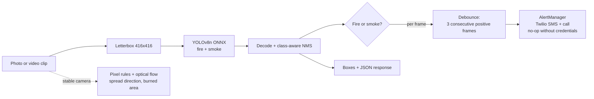

# Fire-Vision: forest fire and smoke detection

[](https://github.com/Anshul3977/Fire-Vision/actions/workflows/ci.yml)

Detects fire and smoke in photos and video, tracks how fire spreads and which way smoke moves, and raises an alert after a few consecutive positive frames.

**Live demos**
- **In-browser demo (Hugging Face Space):** https://huggingface.co/spaces/ANSHUL3977/fire-vision-demo. Upload a photo or short clip; the model runs on your own CPU with ONNX Runtime Web, nothing is uploaded.
- **REST API (FastAPI + ONNX Runtime on Vercel):** https://fire-vision-anshul.vercel.app ([OpenAPI docs](https://fire-vision-anshul.vercel.app/docs))

SMS and call alerts are switched off in both demos.



## Results (measured)

**Accuracy.** `fire_smoke_dfire.onnx` is YOLOv8n fine-tuned on 8,000 D-Fire images (12 epochs, CPU) and evaluated on the full D-Fire test split (4,302 images, 5,186 boxes):

| Class | Precision | Recall | mAP50 | mAP50-95 |
|-------|-----------|--------|-------|----------|
| all   | 0.643 | 0.568 | 0.611 | 0.324 |
| smoke | 0.671 | 0.638 | 0.675 | 0.381 |
| fire  | 0.614 | 0.498 | 0.547 | 0.267 |

**CPU latency.** 200 iterations after 20 warm-up runs on a shared 8 vCPU Intel Xeon VM. *Pipeline* is letterbox + inference + decode + NMS on a real 960x720 photo.

| Model | Runtime | Input | Threads | Forward p50 / p95 | Pipeline p50 / p95 | Pipeline FPS |
|-------|---------|-------|---------|-------------------|--------------------|--------------|
| fire_smoke_dfire | ONNX Runtime | 416 | 1 | 29.9 / 34.6 ms | 35.0 / 56.4 ms | 25.7 |
| fire_smoke_dfire | ONNX Runtime | 416 | 4 | 15.7 / 16.8 ms | 18.0 / 21.6 ms | 54.0 |
| fire_smoke_dfire | PyTorch (fused) | 416 | 4 | 23.5 / 29.5 ms | n/a | n/a |
| fire_obb (v1) | ONNX Runtime | 640 | 4 | 42.1 / 44.7 ms | 44.6 / 53.1 ms | 22.9 |
| yoloNano (original) | PyTorch | 640 | 4 | 48.7 / 55.7 ms | n/a | n/a |

ONNX Runtime is about 1.5x faster than PyTorch for the same model and thread count (15.7 vs 23.5 ms forward p50). Raw numbers are in `service/benchmarks/results/`. Reproduce with `python service/benchmarks/latency.py --threads 1 4 --iters 200`.

## API

```bash
curl -F file=@service/public/samples/forest-burn.jpg https://fire-vision-anshul.vercel.app/api/detect
curl -F file=@service/public/samples/forest-burn-pan.mp4 "https://fire-vision-anshul.vercel.app/api/detect/video?sample_fps=2"
```

| Endpoint | What it does |
|----------|--------------|
| `GET /api/health` | Model, classes, input size, runtime |
| `GET /api/models` | Available models (`dfire` default, `obb-v1`) |
| `POST /api/detect` | One image: boxes, labels, confidences, timings |
| `POST /api/detect/video` | Short clip sampled at `sample_fps`; reports positive frames and when an alert would fire (`alert_after` consecutive frames) |

Run it locally:

```bash
cd service && pip install -r requirements.txt && uvicorn index:app --port 8000
# or
docker build -t fire-vision service && docker run -p 7860:7860 fire-vision
```

## Tests and CI

```bash
pip install -r service/requirements-dev.txt
pytest
```

The suite covers the detector (letterbox, rotated-IoU and box NMS, real sample images), the API (image, video, validation errors) and the alert manager (no credentials means a no-op, Twilio failures never crash, one alert per session). GitHub Actions runs the tests, then builds the Docker image and smoke-tests the container with a real image and clip.

## Repository layout

```
├── service/            # FastAPI + ONNX Runtime API, models, benchmarks, training script, HF Space
│   ├── firevision/     # detector, API, pixel-rule helpers
│   ├── hf-space/       # static in-browser demo (ONNX Runtime Web)
│   ├── benchmarks/     # latency.py + results/
│   └── training/       # train_dfire.py (reproduces the D-Fire model)
├── code_web/           # original Flask + Socket.IO app (spread and smoke-direction analysis)
├── tests/              # pytest suite
└── notebooks/          # experiments
```

## Original Flask app

The first version of the project is a Flask + Socket.IO app that streams processed video and plots spread analytics.

### Features

- **Fire Detection**: YOLOv8-based object detection for fire and smoke
- **Fire Spread Analysis**: Tracks fire progression and calculates spread direction using optical flow
- **Smoke Detection**: Detects smoke patterns and movement direction
- **Real-time Monitoring**: Live video processing with WebSocket streaming
- **Alert System**: SMS and call alerts via Twilio integration
- **Analytics Dashboard**: Visual graphs showing burned area, spread rate, and smoke dispersion

### Tech Stack

- **Backend**: Flask, Flask-SocketIO
- **Computer Vision**: OpenCV, YOLOv8 (Ultralytics)
- **Analysis**: NumPy, Matplotlib
- **Alerts**: Twilio API
- **Frontend**: HTML, CSS, JavaScript, jQuery

### Installation

1. Clone the repository
2. Install dependencies:
```bash
pip install -r requirements.txt --break-system-packages
```

3. Set up environment variables:
```bash
export TWILIO_ACCOUNT_SID="your_account_sid"
export TWILIO_AUTH_TOKEN="your_auth_token"
export TWILIO_PHONE="your_twilio_phone"
export ALERT_PHONE="recipient_phone"
```

### Usage

1. Start the Flask server:
```bash
cd code_web
python app.py
```

2. Open browser and navigate to `http://localhost:5000`

3. Upload a video file and configure analysis parameters:
   - **Size Factor**: Resize video for faster processing (1-2 recommended)
   - **Frames for Smoke Analysis**: Number of frames to average smoke direction (default: 30)
   - **Frames for Fire Analysis**: Number of frames to track fire spread (default: 180)
   - **Camera Stable**: Enable for fixed camera footage to analyze fire/smoke movement

4. Click "Upload Video" to start processing

### Key Components

#### Fire Detection (`fire_flow.py`)
- 7-rule pixel segmentation for fire detection
- Contour-based fire area calculation
- Fire centroid tracking for spread analysis

#### Smoke Detection (`smoke_flow.py`)
- HSV color space thresholding
- Optical flow analysis using Farneback method
- Smoke direction calculation

#### YOLO Detection (`yolo_detection.py`)
- Pre-trained YOLOv8 model for fire/smoke detection
- Oriented bounding box support
- Real-time object tracking

#### Analysis (`analysis.py`)
- 4-panel visualization dashboard:
  - Cumulative burned area over time
  - Rate of area change
  - Smoke dispersion direction (polar plot)
  - Fire spread path with ignition and current front markers

### Alert System

The system automatically sends alerts when fire or smoke is detected:
- **SMS Alert**: Text message via Twilio
- **Voice Call**: Automated call notification
- Alerts are triggered once per session to prevent spam
- Without all four `TWILIO_*`/`ALERT_PHONE` variables (or with `ALERTS_ENABLED=0`) alerts are a logged no-op, so the app runs fine with no Twilio account

### Original model results

These are from the original OBB training runs (see `notebooks/`); they are on a different dataset from the D-Fire numbers above.

| Model | Precision | Recall | mAP@50 | mAP@50-95 |
|-------|-----------|--------|--------|-----------|
| YOLO-v8-obb PT v0 | 92.5% | 89.2% | 94.5% | 63.2% |
| YOLO-v8 PT | 90.0% | 83.0% | 89.0% | 55.3% |
| YOLO-v5-NU | 89.9% | 81.1% | 87.2% | 55.2% |

### Project Structure

```
├── code_web/
│   ├── app.py              # Main Flask application
│   ├── fire_flow.py        # Fire detection logic
│   ├── smoke_flow.py       # Smoke detection logic
│   ├── yolo_detection.py   # YOLO model inference
│   ├── analysis.py         # Graph generation
│   ├── static/             # CSS, JS, JSON files
│   └── templates/          # HTML templates
├── notebooks/              # Jupyter notebooks for experimentation
├── models/                 # Pre-trained YOLO models
└── requirements.txt        # Python dependencies
```

Sample photos: U.S. Fish & Wildlife Service, public domain. Training data: D-Fire (Venâncio et al., 2022, CC BY 4.0).
